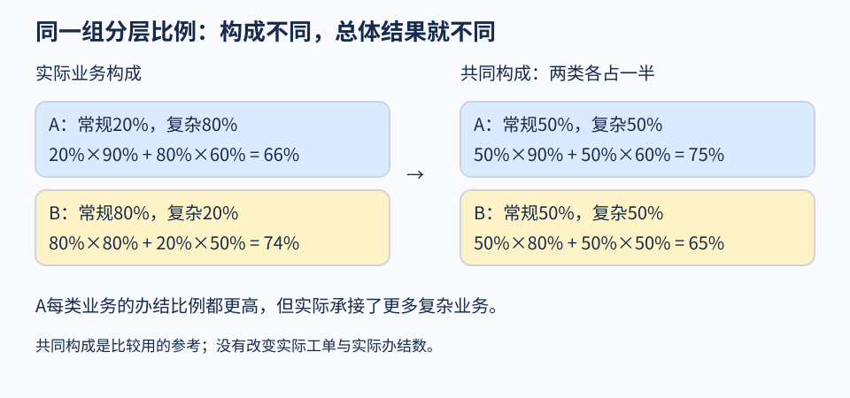

# 第06课 · 每类业务都办得更好，合起来却更低？

中心A和B都办理常规业务与复杂业务。A在每类业务中的办结比例都较高，总体办结比例却可能较低。这并不是加法出错，而是两中心接到的业务数量不同。

本课先合计实际办结数，再分业务比较，最后问一个新问题：如果两中心面对相同的业务构成，比较会怎样？

**当日办结比例**（same-day completion rate）= $\text{当日办结数}\div \text{全部登记工单数}$ 。本课这个分母包括未办结和放弃的工单，不能为了提高比例先删掉它们。

## 先做一个小判断

如果两个中心承接的复杂业务比例不同，只看各中心的一个总体比例，可能漏掉什么？先写下你想保留的分组信息，再读例子。

## 1. 先看一张计数表

下表是另设的例子。“办结数/工单数”中的分母包括该类业务的全部登记工单。

| 中心 | 常规业务：办结数/工单数 | 复杂业务：办结数/工单数 |
|---|---:|---:|
| A | 18/20 | 48/80 |
| B | 64/80 | 10/20 |

把两类业务合在一起计算，得到**合并比例**（pooled proportion），也称边际比例。A为 $(18+48)\div (20+80)=66\%$ ；B为 $(64+10)\div (80+20)=74\%$ 。合并时要合计分子和分母，不能直接平均两个百分比；A 的两类业务工单数差很多，简单平均会改变它们所占的份额。

## 2. 在同类业务中比较

**分层比较**（stratified comparison）是先按业务类型等特征分组，再在同类业务内部比较。每组也称一层；该层办结数除以该层全部登记工单数，就是**分层办结比例**（stratum-specific completion rate）。

A在常规、复杂业务中的比例分别为90%、60%；B分别为80%、50%。A在两类业务中都高于B，合并后却较低。这种合并比较的方向与每一层内部比较的方向相反的现象称为**辛普森悖论**（Simpson’s paradox）。

这里应先看构成：A的复杂业务占80%，B只占20%。把总体比例写开，更容易看见原因：

- A： $20\%\times 90\%+80\%\times 60\%=66\%$ ；
- B： $80\%\times 80\%+20\%\times 50\%=74\%$ 。

A的大部分工单落在办结较难的复杂业务中。两中心承接的业务组合不同，所以合并结果与分层结果可以同时算对，却回答不同问题。

## 3. 用共同权重进行直接标准化

**权重**（weight）表示各类业务在指定构成中所占的份额。**直接标准化**（direct standardization）是先指定一组共同业务构成，再用这组相同权重对各中心的分层比例加权。这样比较时，各中心使用的业务构成相同；选哪组构成，应由要回答的问题决定。

先从表中计算当前共同构成：两中心共有200张工单，其中复杂业务 $80+20=100$ 张，因此复杂业务权重为 $100\div 200=0.5$ ，常规业务也为0.5。

可以想象一份两类各占一半的参考业务组合。不是给A删工单，也不是给B添工单，只是在计算时给两类相同份额。

采用这个共同构成时，A的**标准化办结比例**（standardized completion rate）为 $0.5\times 90\%+0.5\times 60\%=75\%$ ，B为 $0.5\times 80\%+0.5\times 50\%=65\%$ 。可以把它理解成一份假想的100张工单：两类各50张。沿用A已观察到的两类办结比例，算得 $45+30=75$ 张；沿用B的比例，算得 $40+25=65$ 张。这是参考构成下的计算，并不是新观察到100张工单。若另设计划让复杂业务占75%，常规占25%，则A为67.5%，B为57.5%。后一计划是教学情境，不是原数据事实。



左侧按各中心自己的业务构成计算实际比例，右侧给两中心相同构成。各业务层的办结比例没变，改变的是两类业务在计算中的份额。

所有中心必须采用同一组权重，权重均不小于0且合计为1。只改变A的权重而让B继续使用自身构成，不是共同标准下的比较。标准化结果也不能用来改写实际办结数：A原来的实际办结比例仍是66%。

把共同权重写成公式，令 $w$ 为复杂业务所占比例，则常规业务占 $1-w$ ，其中 $0\leq w\leq1$ 。本例的两项标准化比例为：

$$
\begin{aligned}
p_A(w)&=0.9(1-w)+0.6w,\\
p_B(w)&=0.8(1-w)+0.5w.
\end{aligned}
$$

两式相减为0.1，即10个百分点。若其他数据的层内差异方向不同，改变共同构成也可能改变比较方向，下一节讨论怎样检查。

## 4. 改变共同构成后，方向会不会变

**敏感性分析**（sensitivity analysis）是检查共同权重改变后，比较方向或差距会怎样变化。本例A在两层都比B高10个百分点。因此，无论共同构成中两类业务各占多少，加权后的差异仍为10个百分点。这是方向稳定的结果，不必为了做敏感性分析而制造反转。

百分点（percentage point）是两个百分比相减的单位。75%比65%高10个百分点，不是相对增加10%。结论稳定只针对这里的分层结果和共同权重，不能据此保证未来时期也一样。

**方向不变，不等于差值大小不变。** 上例差值始终为10个百分点，是因为两层差值恰好相等。另设两层中A分别比B高20和5个百分点：两层各占一半时，加权差为 $0.5\times 20+0.5\times 5=12.5$ 个百分点；第二层占75%时，为 $0.25\times 20+0.75\times 5=8.75$ 个百分点。两次都是A较高，但差距不同。因而报告要同时说明方向与大小。

## 5. 没有记录的业务层怎样处理

某中心没有承接某类业务时，该层比例没有分母，不能记为0或100%。例如“0张复杂工单，0张办结”是 $0/0$ ，无法计算；“10张复杂工单，0张办结”才是 $0/10=0\%$ 。两种情况要分开记录。若目标构成给这一层正权重，就不能直接根据现有数据计算完整的标准化比例。

可以限制到各中心都有资料的业务类型，并说明结论只适用于这些业务。不能让每个中心各删不同的缺失层，再声称使用了相同构成。计算应使用原始计数，最后显示时再四舍五入。

## 在项目中使用

并列展示实际合并比例、分层比例和共同构成下的结果。至少比较当前整体构成与另一个有明确用途的共同构成，再决定是否发布排名或改用分层表。

直接标准化只调整了用于分层的业务类别构成。业务类别内部的难度、人员配置等仍可能不同，所以标准化后的差异不能直接证明调配人员或改变管理办法会产生什么效果。

## 按需阅读：中心规模不同时的总体权重

另设A有100张工单，其中80张复杂；B有300张，其中60张复杂。全部工单的复杂业务比例为 $(80+60)\div (100+300)=35\%$ ，不是把80%和20%直接平均得到的50%。后者给两个中心相同的份额，前者按各中心工单数合计，回答的问题不同。选择当前全部工单的构成时，应使用35%。

## 用Python核对例子（可选）

代码输入是小表中的四个“办结数、工单数”组合。先算各层比例，再用共同权重加权，结果打印在终端。

先检查 `actual` 中A为0.66、B为0.74，再看 `w50` 中A为0.75、B为0.65。同一中心的actual与w50回答不同问题，不是其中一个修正了另一个真实办结数。

<details>
<summary>展开核算代码</summary>

```python
# learning-example
import json
counts = {"A": [(18, 20), (48, 80)], "B": [(64, 80), (10, 20)]}
rates = {c: [s/n for s, n in cells] for c, cells in counts.items()}
def standard(w):
    return {c: (1-w)*r[0]+w*r[1] for c, r in rates.items()}
result = {"actual": {c: sum(s for s,n in cells)/sum(n for s,n in cells) for c,cells in counts.items()},
          "w50": standard(.5), "w75": standard(.75),
          "endpoint_differences": [standard(w)["A"]-standard(w)["B"] for w in (0, 1)]}
print(json.dumps(result, ensure_ascii=False, allow_nan=False))
```

</details>

## 完成到什么程度？

- **基础完成**：复算A、B的实际合并比例和分层比例，解释为什么每层较高与总体较低可以同时成立。
- **完整完成**：按[任务页](README.md)并列给出实际、分层和共同构成下的结果，用一个有理由的替代构成检查建议。
- **扩展练习**（选做）：比较下方第2道题的两个端点权重，再求中间并列的位置。先画一条从0到1的权重线，标出哪一段甲高、哪一段乙高；不要把这组人工变式当作正式数据的结果。

## 独立自检：改变比较目标

这些本地变式不属于线上 A/B 题，不产生线上作答记录。

1. 两中心工单量分别 100 和 300，复杂工单分别 80 和 60。以全部工单构成为共同标准时，复杂业务的权重是多少？平均两个中心的复杂业务比例是在回答什么问题？
2. 另设甲常规办结比例90%、复杂60%，乙常规80%、复杂70%。共同构成中复杂业务的比例 $w=0$ 、0.5、1 时谁较高？排名改变的位置在哪里？
3. 某中心常规比例90%、复杂60%。情境规定共同构成下比例至少80%才采用某项建议。它在什么权重范围达到要求？这样的要求能否改变已观察的办结数？
4. 某中心没有复杂业务记录，常规办结比例80%；目标构成中复杂业务占40%。完整标准化值可算吗？若没有记录的复杂层办结比例可以在0—1之间，它的标准化结果范围是多少？

<details>
<summary>展开逐步反馈</summary>

1. 按工单合计为 $(80+60)/(100+300)=35\%$ 。平均80%与20%为50%，给两个中心同等份额，描述平均中心构成；它与全体工单构成目标不同。
2. 甲为 $0.9-0.3w$ ，乙为 $0.8-0.1w$ ，差为 $0.1-0.2w$ 。 $w=0$ 甲高10个百分点，0.5并列，1乙高10个百分点；零点0.5。它是另一组数据，与正式项目不同，不能为找反转而篡改正式数据。
3. $0.9-0.3w\ge 0.8$ ，所以 $0\le w\le 1/3$ 。这一情境要求改变建议，不能改写实际办结数，也不能声称未观察到的未来一定达标。
4. 复杂业务占目标构成的40%，但该中心没有这类记录，因此不能直接得到一个确定的标准化值。设复杂层比例 x在0—1，结果为 $0.6\times 0.8+0.4x$ ，范围48%—88%。这个范围来自没有资料的业务层，不是描述抽样估计不确定性的置信区间。只比较常规业务可得80%，但目标已限制到常规，所有中心须用同一业务范围。

</details>

## 按需阅读：权重差值为何支持范围判断

始终按“中心甲减中心乙”计算差值：令 d常规 为常规层比例之差，d复杂 为复杂层比例之差。共同构成中复杂业务占比为 w， $0\le w\le 1$ ，标准化比例之差为 $(1-w)d_{\text{常规}}+wd_{\text{复杂}}$ 。当 $w=0$ 时，差值为 d常规；当 $w=1$ 时，差值为 d复杂。这就是两个端点。由于两类权重非负且合计为一，加权差落在两端点差值之间。两端点均为正时，整个0—1范围内都是甲较高；均为负时，都是乙较高。端点一正一负时，可求两中心相等的权重；两端点相同时，差值恒定。差值若用0—1的比例计算，乘以100后以“百分点”报告。

方向稳定不保证差距大，也不保证满足某个用途的要求。公式针对现有分层比例与指定构成，不处理未记录难度差异，不自动支持中心能力或人员调配的因果解释。
