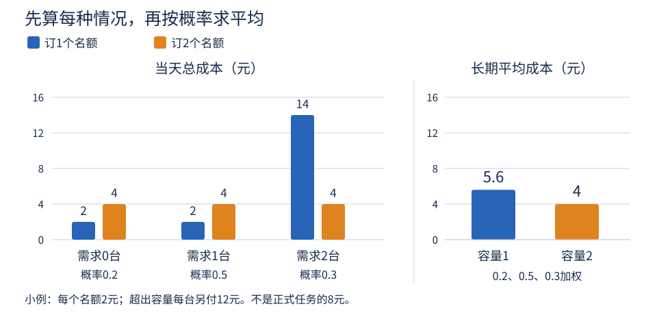

# 第10课 · 平均每天来这么多请求，名额也订这么多吗？

上一课，我们根据筛查结果安排复核。本课换一个问题：明天究竟会有多少台设备需要复核，现在还不知道；可是复核名额要提前预订。

订少了，会有设备需要转送；订多了，空着的名额也要付钱。怎样把这种不确定性算进安排里？

先用一个很小的例子，把“可能发生什么”与“发生以后怎么办”分开看。

## 1. 明天的需求不是一个已经知道的数

假设一个小服务点每天可能收到0、1或2台设备的复核请求。我们为教学设定下面这个模型：

|一天收到的请求数|0台|1台|2台|
|---|---:|---:|---:|
|发生的概率|0.2|0.5|0.3|

可以把它理解为：如果长期按照这个模型运行，约20%的天没有请求，约50%的天有1台，约30%的天有2台。不是说任意10天都一定恰好出现2、5、3次。

还没有观察到、可能取不同数值的数量，叫作**随机变量（random variable）**。这里用D表示一天的请求数。

上表把D可能取的值和各自的概率列了出来，这叫作**概率分布（probability distribution）**。三种情况已经包括所有可能，因此概率之和应为1。

这张表是我们对需求的设定。它可以用来推算后果，但不能保证现实永远按表发生。

## 2. 平均需求1.1台，并不是每天都来1.1台

把每种需求乘上它发生的概率，再相加：

**平均需求 = 0×0.2 + 1×0.5 + 2×0.3 = 1.1台。**

这个按概率加权的长期平均，叫作**期望（expected value）**，常写成E(D)。

一天实际收到的仍然是0、1或2台，不会收到1.1台。1.1描述的是长期平均，不是对明天数量的保证。

这里不能直接把0、1、2相加再除以3。那样等于假定三种情况一样常见，而上表并不是这样。

### 平均相同，需求仍可能很不一样

再比较两个另外设定的服务点：

- 甲：每天都收到1台，平均是1台。
- 乙：一半的天没有请求，另一半的天收到2台，平均也是1台。

如果两个服务点都只订1个名额，甲从不短缺，乙却有一半的天短缺。

因此，“平均需求相同”不能推出“订同样的名额，后果就相同”。我们还需要看需求怎样波动。

## 3. 方差描述波动，但不直接等于损失

回到最初0、1、2台的小例。平均是1.1台，各种需求与平均值的差分别是−1.1、−0.1、0.9台。

把这些差平方，再按概率加权：

**方差 = 0.2×(0−1.1)² + 0.5×(1−1.1)² + 0.3×(2−1.1)² = 0.49台²。**

这就是**方差（variance）**。平方可以避免正负差互相抵消，也会让较大的偏离占更大权重。

方差的单位是“台²”，不太方便直接解释。开平方后得到**标准差（standard deviation）**：

**标准差 = √0.49 = 0.7台。**

它用与需求相同的单位描述波动大小。它不是说需求一定落在1.1上下0.7台以内。

方差和标准差只描述需求分布。要计算部门会花多少钱，还要知道订了多少名额、闲置怎样收费、短缺怎样处理。

## 4. 先看某一天，再算长期后果

假设提前订C个名额。C叫作**容量（capacity）**，也就是当天最多能在本部门复核的台数。

若当天来了D台，则：

**短缺台数 = max(0，D−C)。**

max表示“取其中较大的数”。例如订1个名额：

- 来0台：没有短缺，不能记成−1台；
- 来1台：刚好够用；
- 来2台：短缺1台。

现在另定小例的费用：每个预订名额花2元，用没用都要付；每台超出容量的设备转送到外部，另花12元。

所以：

**一天的总成本 = 2×预订名额 + 12×短缺台数。**

注意：12元只乘超出容量的台数，不乘全部请求数；闲置名额也没有退款。

### 订1个还是2个？

把每一种可能情况都算出来：

|需求D|概率|订1个：短缺|订1个：总成本|订2个：短缺|订2个：总成本|
|---|---:|---:|---:|---:|---:|
|0台|0.2|0台|2元|0台|4元|
|1台|0.5|0台|2元|0台|4元|
|2台|0.3|1台|14元|0台|4元|

订1个名额，只有需求为2台时短缺，因此**短缺概率（shortage probability）是0.3**。

但长期平均的短缺台数与短缺概率是不同概念：

- 短缺概率：有多少比例的天不够用；
- 平均短缺台数：每天平均有多少台需要转送。

本例每次短缺恰好都是1台，所以两者的数值碰巧都是0.3。若每次短缺10台，就不能混用。

## 5. 把每天的成本按概率平均

订1个名额时，长期平均成本是：

**0.2×2 + 0.5×2 + 0.3×14 = 5.6元。**

订2个名额时，无论当天来多少台，都花4元，长期平均成本也是4元。

多订一个名额，预订费增加了2元，却省下了平均0.3×12=3.6元的转送费。所以，长期平均总成本反而下降1.6元。

**图1怎么读：**左边比较的是某种需求真的发生时要花多少钱，右边比较的是按三种情况的概率加权后的长期平均。不能把左边三个柱子简单等权平均，因为三种情况的概率不同。

这个结果不意味着容量永远越大越好。本例最多来2台，如果订3个名额，每天花6元，却不能再减少短缺。

同样，若转送费降到2元，订1个名额的平均成本会变成2+0.3×2=2.6元，比订2个名额的4元更低。

需求分布告诉我们“可能发生什么”，费用和服务要求决定“哪种后果更值得避免”。两者都影响选择。

## 6. 不只问平均花费，还要问忙的时候怎么办

平均成本低，不代表每一天都便宜，也不代表短缺的那几天能够承受。

本课可以从三个角度比较容量：

1. **平均总成本：**长期每天平均花多少钱？
2. **短缺概率：**有多大比例的天名额不够？
3. **较忙时的短缺规模：**绝大多数天，短缺不超过多少台？

第三个问题可以用**分位数（quantile）**回答。本课统一采用“累计概率（cumulative probability）第一次达到指定比例”的定义。累计概率就是把不超过某个数的情况的概率加起来。

例如某安排的短缺情况如下：

|短缺台数|0台|1台|4台|
|---|---:|---:|---:|
|概率|0.60|0.35|0.05|
|累计概率|0.60|0.95|1.00|

95%分位数是1台，因为不超过1台的累计概率已经达到95%，而不超过0台只有60%。

这不代表短缺一定不超过1台。剩下5%的天仍然会短缺4台。在这个模型里，最大可能短缺是4台。

不同软件的分位数算法可能不同，有些会在相邻数值之间插值。本课的离散分布直接按上述累计概率计算；比较方案时不要混用定义。

## 7. 已经能精确计算，为什么还要模拟？

前面只有三种需求，可以逐项算完，再按概率加权。这叫作**精确枚举（exact enumeration）**。

还可以请计算机按0.2、0.5、0.3的概率，一天一天产生可能的需求。这种反复随机抽取、再统计结果的方法叫作**蒙特卡洛模拟（Monte Carlo simulation）**。

例如模拟得到前五天需求为1、2、1、0、2。订1个名额时：

- 五天短缺依次为0、1、0、0、1台；
- 五天成本依次为2、14、2、2、14元；
- 这五天平均成本为34÷5=6.8元。

6.8不等于精确平均5.6，并不自动说明程序错了。只模拟五天，偶然出现的大需求日会明显影响结果。增加模拟天数，平均值通常会更稳定，但仍不要求与精确值一模一样。

**随机种子（random seed）**用来固定随机数生成过程。同样的代码、种子和环境有助于重现同一批模拟需求；换一个种子，可以观察模拟结果本身的波动。

### 比较容量时，先抽一批天，再比较两个方案

不要给方案甲抽一批较清闲的天，再给方案乙抽一批较忙的天。

更清楚的做法是：先生成一批需求，将同一批需求分别代入两种容量。这样每一天面对的需求相同，比较的是容量安排的差异。

独立抽取两批天也能用来估计平均后果，但差异中会多出两次抽样的随机波动。本课用同一批天，便于核对和解释。

模拟更多天，只会让“在这个模型下”的计算更稳定。它不会减少真实需求的波动，也不会修正不合适的模型。

## 8. 回到正式任务：为什么给两种需求情境？

正式数据在本课的data/demand.csv中。每行是一种可能的日需求，不是一天的实际业务记录。

数据给了两种教学设定：

|情境|日需求及其概率|
|---|---|
|base：基准情境|40台：0.20；80台：0.60；160台：0.20|
|stress：压力情境|40台：0.55；80台：0.20；200台：0.25|

两种情境的平均需求都是88台。但是大需求日的大小和发生概率不同。你需要看看：原来选的容量，在另一种需求分布下是否仍合适。

正式任务每个预订名额花2元，每台短缺另付8元，预订预算为240元。因此最多预订120个名额。**240元只约束提前预订的支出，转送费仍要另算，实际总成本可能超过240元。**

这些数字与前面的小例不同，请不要直接复制小例结论。

这里研究的是“每天请求数怎样波动”。上一课研究的是“单台筛查阳性意味着什么”。二者相关，但本课没有从上一课的故障率推导这两张需求表；它们是另设的批次需求模型。

## 9. 给出建议，不需要把所有可能都研究完

你可以先选两个有理由的容量，分别算出平均成本、短缺概率与95%短缺分位数，再比较基准和压力情境。

只要说明自己优先考虑什么，就可能出现不同的合理建议。例如：“我愿意接受稍高的平均成本，以减少繁忙日的转送规模。”也可以依据计算保留原方案。

最后把边界说清楚：这里的请求当天处理或转送，没有积压到第二天；模拟也没有默认研究连续忙碌日之间的关联。如果真实业务会积压，或者大需求常常连续出现，就需要另建模型。

本课的重点不是找到一句“最优容量是某个数”，而是能解释：这个容量为什么适合当前需求、费用和服务目标。
