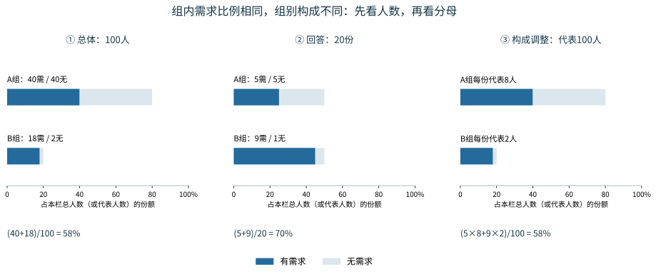

# 第11课 · 回答的人很多，就能代表所有人吗？

## 1. 服务部门想知道谁的需求？

服务部门准备安排下个周末的窗口，想知道：名册中的4000人，有多少人至少需要一次服务？需要多次服务的人也只计为一名有需求者。本课用教学合成数据练习这个问题。

这4000人是本次研究的**目标总体**。有需求记为1，没有需求记为0；总体需求比例就是“有需求人数÷4000”。调查要用一部分人的回答估计这个比例。

调查前先看 `data/frame.csv`。它有4000人的编号、A/B组别和是否在网上联系名单中，**没有需求结果**。因此，拿到这份名册时，我们能规划联系谁，还不知道谁有需求。

## 2. 从名册到回答，中间发生了什么？

先问三个问题：**这种方式能联系谁？这次邀请了谁？最后谁回答了？**

实际用来抽人的名单叫**抽样框**。例如，网上邀请只能从网上名单中抽人；名单外的人在这种方式下没有受邀机会，这叫覆盖不足。名单内的人也可能没有抽中；抽中并收到邀请后，还可能没有回答，这叫无回答。

取得回答后，`observations.csv` 仍保留4000行，每行记录一个人的 `in_frame`（是否在框内）、`invited`（是否受邀）和 `answered`（是否回答）。这些状态让我们能查清需求信息在哪一步没有取得。

只有 `answered=1` 时，`observed_need` 才观察到0或1。其余行的需求为空，工具读回为 `None`，表示未知；0则表示这个人明确回答“没有需求”。计算回答者需求比例时，用的是已经回答的那些人。

接下来看一个小例：即使每份回答都记录正确，直接合并得到的比例也可能偏离总体。

## 3. 20份回答，为什么得到70%？

暂把总体缩小到100人。A组有80人，其中40人有需求、40人没有需求，组内需求比例为40/80＝50%。B组有20人，其中18人有需求、2人没有需求，组内需求比例为18/20＝90%。一次调查恰好收到两组各10份回答：

|组别|总体有需求|总体无需求|回答有需求|回答无需求|
|---|---:|---:|---:|---:|
|A|40人|40人|5份|5份|
|B|18人|2人|9份|1份|

把20份回答直接合并，得到：

**回答者需求比例＝（5＋9）÷20＝70%。**

A组回答中的需求比例是5/(5＋5)＝50%，B组是9/(9＋1)＝90%，都恰好与本组总体相同。但B组在总体中只占20/100＝20%，在回答中却占了10/20＝50%。直接合并时，高需求B组的份额被放大，所以合并比例被推高。

## 4. 按总体份额合并，得到58%

我们想了解的是原来那100人，因此让A组仍占80%、B组仍占20%。把两组回答中的需求比例按这两个份额合并：

**调整比例＝0.8×50%＋0.2×90%＝58%。**

这里0.8和0.2是已知的总体组份额，50%和90%是各组回答中的需求比例。这种计算叫**按总体构成加权**：组内比例来自回答，组别份额取自总体。

这个小例还给出了完整总体，因而可以核对：A组有80×50%＝40人有需求，B组有20×90%＝18人有需求。真实总体比例为：

**（40＋18）÷100＝58%。**

本次调整与真值相同，是因为两组回答中的需求比例都恰好符合各组总体。

图中蓝色表示有需求。中间一栏把A/B各算一半，得到70%；右栏恢复总体的80%/20%份额。也可以把A组每份回答看作代表8人、B组每份代表2人，算出的仍是同一个58%。

这项计算需要两组都有需求比例。若B组无人回答，B组比例和调整结果都暂留未知；要继续估计，就需要补采B组信息，或明确采用什么额外假设。

## 5. 组别份额调对，为什么还会得到82%？

仍用同一个100人总体。现在设想每个人都有回答机会，但同组内有需求者更愿意回答。下面列出一次说明性调查收到的回答：

|组别|总体有需求|总体无需求|这次回答有需求|这次回答无需求|回答者需求比例|
|---|---:|---:|---:|---:|---:|
|A|40人|40人|8份|2份|8/(8＋2)＝80%|
|B|18人|2人|9份|1份|9/(9＋1)＝90%|

对照上一次：A组原来收到5份有需求、5份无需求的回答，这次收到8份有需求、2份无需求的回答；B组两次都是9份有需求、1份无需求。两组仍各有10人回答，A组回答者的需求比例却从50%变成了80%。

这里的8份与2份是一次说明性结果，不是4000人模拟器规定的固定回答率。

总体中A/B仍各占80%/20%。把这次回答者的组内比例80%和90%乘入这两个总体份额，得到：

**0.8×80%＋0.2×90%＝82%。**

更愿意回答改变了谁被观察到，没有改变谁有需求：A组仍是40人有需求、40人无需求，全组需求比例仍为40/80＝50%；全体真值也仍为(40＋18)/100＝58%。加权虽然调对了两组份额，却把A组回答者的80%用作整个A组的估计，因而仍然偏高。这就是组内回答选择留下的偏差。

因此，加权时要问两件事：组别份额是否符合目标总体？各组回答中的需求比例，又有什么依据可以用来估计本组？

## 6. 回到4000人的正式调查

正式数据中A组3200人、B组800人，总体份额仍是0.8和0.2。你要比较两种取得回答的方式：

|方式|从哪里邀请|受邀后的回答规则|
|---|---|---|
|完整名册普通联系 `register_ordinary`|从完整4000人中等概率、无放回抽取|A组回答概率0.8，B组0.6；同组内回答与需求独立|
|网上邀请、自愿回答 `web_voluntary`|只从3305人的网上名单中等概率、无放回抽取|有需求者回答概率0.85，无需求者0.25|

等概率表示框内每个人受邀机会相同；无放回表示一次调查不会重复抽中同一个人。完整名册普通联系的回答率虽然分组不同，但同组内独立于需求，为使用组内回答比例提供了依据。网上方式既有名单覆盖不足，又有需求相关的回答选择，需要结合取得过程判断加权能解决多少问题。

先用不含需求结果的 `frame.csv` 选定相同邀请人数，保存两份方案；再取得回答，查看 `observations.csv` 中的状态并计算两套结果。正式编号追踪和可执行演示见 [SUPPORT](SUPPORT.md)，字段见 [数据说明](data/README.md)。

比较时看回答人数、A/B回答构成、组内需求比例、合并比例和构成调整比例，同时核算邀请费用。每次邀请A组花1单位、B组花3单位，按发出的邀请计费，不包含追访费用；所以相同邀请人数也可能花费不同。

形成估计后，最后用 `audit_population` 揭示这个固定教学合成总体的完整需求，核对估计与总体相差多少，再沿覆盖、邀请和回答过程解释差异。现实调查通常没有这份完整答案，需要依靠取得机制及补充信息判断结论的适用范围。

一次结果较接近总体，可能也有随机波动的作用；判断调查方法还要看它怎样取得回答、加权的依据是否成立。结合这些证据，提出采用哪种调查、优先补充谁的信息，或暂缓推广到全体的建议。

**回答多不等于有代表性。先看谁能进入调查、谁最终回答，再判断这个比例能否用于我们关心的4000人。**
