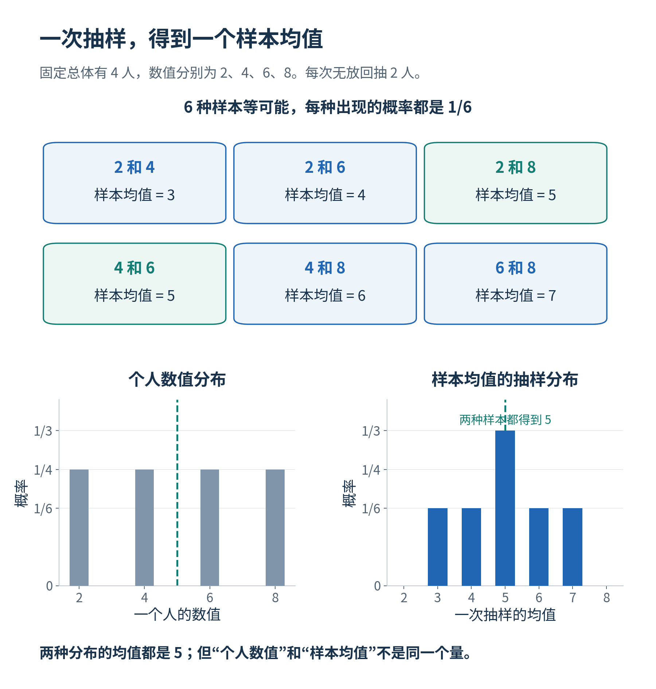
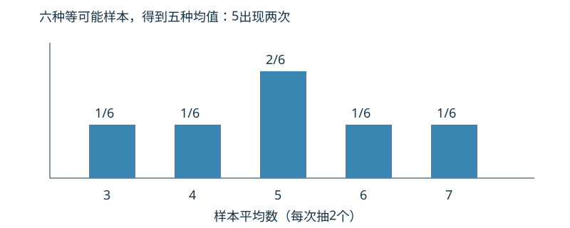
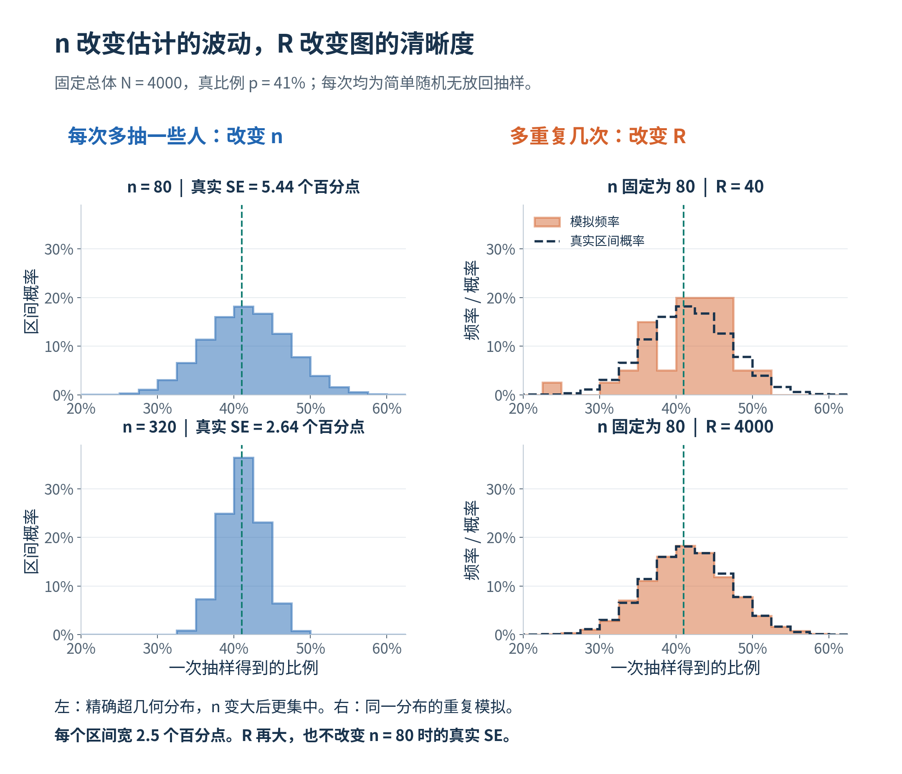
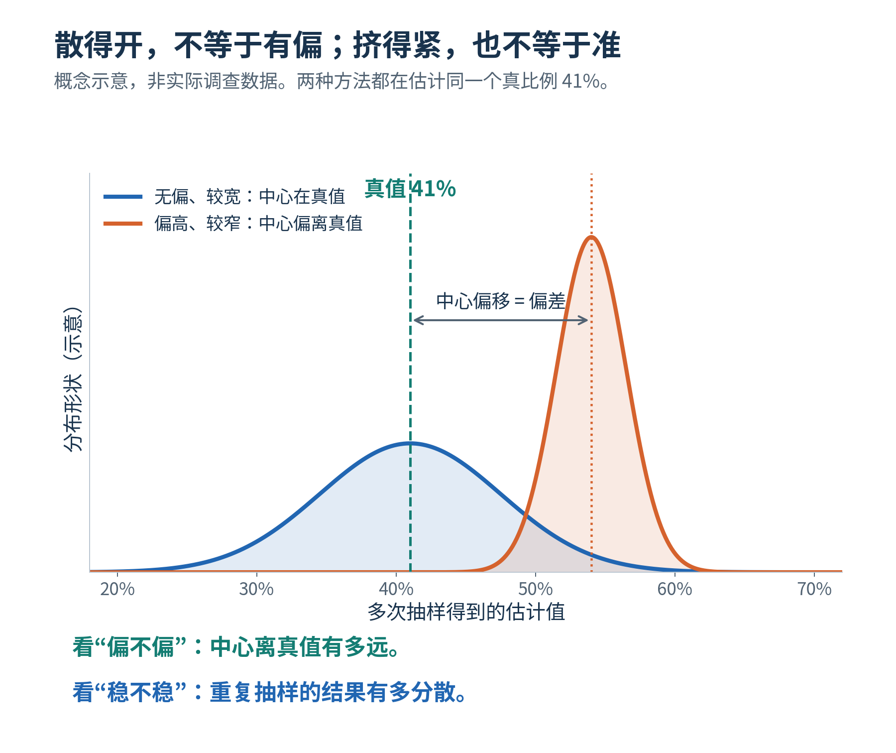
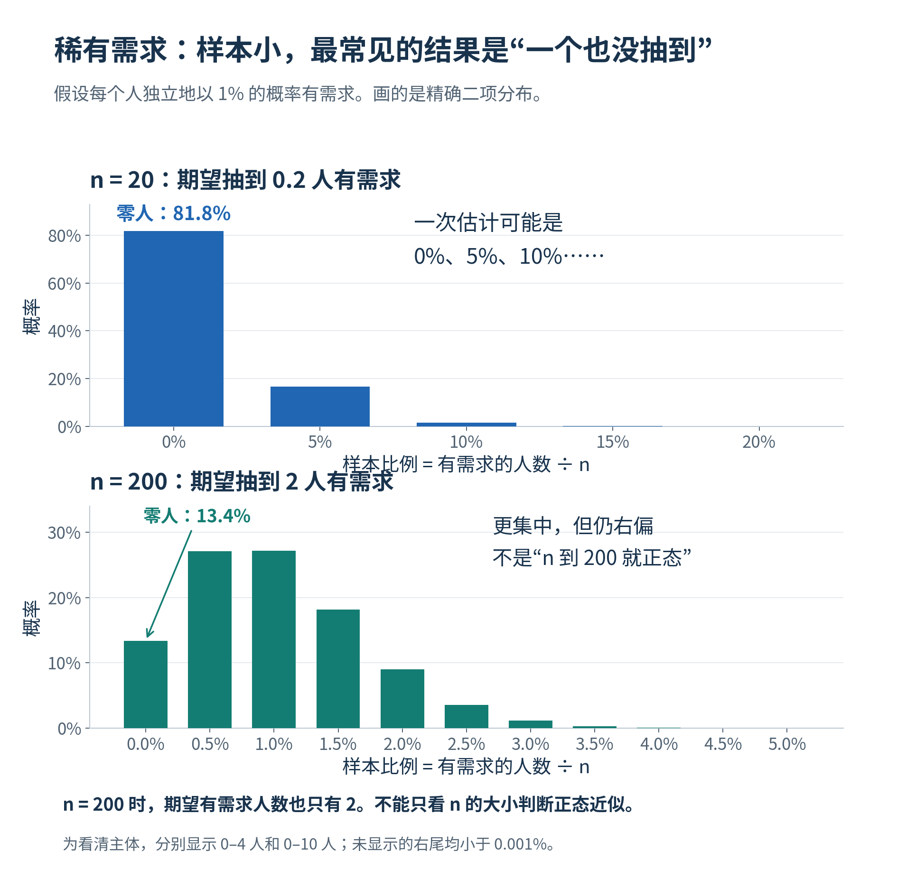

# 第12课 · 换一批样本，估计会差多少？

第11课我们发现：谁被联系、谁愿意回答，会影响调查结果。这次先把这些问题暂时放开，考虑从完整名册随机抽人，而且抽中者都回答。即使如此，两次调查的比例也可能不同。为什么？这种不同通常有多大？

本课只抓住三个问题： **每次算出什么？换一批人会差多少？怎样减少这种差异？**

## 1. 先看一个可以全部列完的例子

有四个人，他们的某项数值分别是2、4、6、8。总体平均数是 $(2+4+6+8)/4=5$ 。

每次等概率、无放回抽两个人，只计算这两人的平均数。共有六种不同的样本，每种机会相同：

|抽中的两个数|这次样本平均数|
|---|---:|
|2、4|3|
|2、6|4|
|2、8|5|
|4、6|5|
|4、8|6|
|6、8|7|

总体没有改变，都是原来那四个人；改变的是这次抽中了谁。因此，样本平均数可能是3，也可能是7。

先记住： **总体的5不变，样本算出的数会变**。 总体的平均数叫**参数**（parameter）；根据样本算平均数的方法叫**估计量**（estimator），这次算出来的4叫**估计值**（estimate）。

先看上面的六种抽法，再比较下面两种分布：右图的每个均值代表一份样本，而不是一个人。

## 2. 两种分布，说的不是同一件事

把原始四个数2、4、6、8画出来，描述的是人的数值如何分布。

把六种样本的平均数3、4、5、5、6、7画出来，描述的是反复抽样时，估计值如何变化。这叫 **抽样分布**（sampling distribution） 。其中平均数5有两种样本能产生，出现概率为2/6；其他四个值的概率各为1/6。

先看横轴，它是一次样本的均值；再看柱上概率，均值5对应两种抽法，所以柱子更高。

所以“收集了500个人的回答”和“重复做了500次调查”不同。前者是一份调查里有500个人；后者每次调查先算一个比例，最后得到500个比例。

## 3. 标准误：估计值的波动有多大？

**标准误**（standard error，SE）描述反复换样本时估计值的波动大小。 数学上，它是估计量抽样分布的标准差。

六个可能均值的平均数仍为5。它们到5的距离是−2、−1、0、0、1、2，平方后为4、1、0、0、1、4。因此：

$$
\text{标准误}=\sqrt{\frac{4+1+0+0+1+4}{6}}=\sqrt{\frac53}\approx1.291.
$$

这里除以6，是因为已经列出了全部六种等可能样本。

相比之下，原始四个数到5的平方距离是9、1、1、9，总体标准差为 $\sqrt{20/4}=\sqrt5\approx2.236$ 。2.236描述人的数值差异，1.291描述每次抽两人所得均值的差异。它们不是同一个量。

标准误也不是某一次估计的实际误差。例如抽到2、6时，估计4与真值5相差−1；这次误差是−1，标准误仍为1.291。

### 有时为什么用“样本标准差除以样本量平方根”？

若每条观测可看作独立同分布，且总体方差有限，样本均值的标准误可用 $\frac{s}{\sqrt n}$  估计，s是这一份样本中原始观测的样本标准差。例如 $s=12$ 、 $n=36$ ，估计SE约为2，不是12。它估计的是“均值会怎样波动”，不是某个个体的变化。

从有限名册无放回抽取时，观测并非严格独立，抽样比例较大还要作有限总体修正。本页末尾给出本课0/1需求比例的对应公式，不能把独立样本公式不加条件地搬到所有调查。

## 4. 总体太大时，用重复模拟近似抽样分布

前面算均值，正式任务算需求比例，两者其实接得上：把有需求记为1、无需求记为0， **这些0/1的平均数就是有需求的比例** 。例如80人中33人有需求，平均数就是33/80。

4000人中抽80人的所有可能组合太多，无法逐个列完。可以重复抽500次，每次从同一个固定总体重新抽一批人，并记录一次需求比例。

得到500个比例后，主要看两件事：

-  **估计的平均数** 靠近总体真值吗？平均估计减去真值，得到模拟的 **偏差**（bias） 。
-  **这些估计分散吗？** 用500个估计值的样本标准差近似标准误。程序在这里用分母499，因为这是抽样分布的一次有限模拟，不是穷尽所有可能样本。

第11课已核对这份合成总体的真实需求比例为41%。本课将它作为检验方法的已知基准，不重新生成一份总体。现实调查一般不知道真值，不能用这种模拟替代对调查机制的调查。

## 5. 样本量增加，与模拟次数增加，有什么不同？

**每次调查人数n增加** ：在合适的概率抽样条件下，每次估计通常更稳定。低抽样比例时，标准误常近似按 $\frac1{\sqrt n}$ 变化。例如样本量扩大到4倍，标准误大约减半，而不是变成四分之一。

**重复次数R增加** ：我们更准确地看清同一种调查方法的波动；它没有改变每次调查的人数，也不会让一次80人调查变成更精确的大调查。

左边改变一次调查的规模；右边只增加同一种调查的模拟次数。 **想让一次调查更稳，不能只把模拟次数调大**。

判断一次调查稳不稳定，先看 `estimated_se`。程序还有 `monte_carlo_se_of_mean`：它衡量多次模拟的平均数还会波动多少，不是单次调查的标准误。其计算见操作参考。

扩大网上自愿调查人数，可能使结果更稳定地停在一个偏高的水平。

这是概念示意，不是本班调查结果。看“中心离真值多远”判断偏差，看“分布有多宽”判断波动。 **集中不一定准确**。

## 6. 为什么有时看见钟形，有时看不见？

在适当的随机抽样条件下，样本量增加时，样本均值或比例的抽样分布常逐渐接近钟形的正态分布。这是 **中心极限定理**（central limit theorem） 所解释的现象。它说的是反复得到的估计值，不是原始0/1需求数据会变成正态。

但样本量“超过30”不是通用保证。另设一个与正式数据不同的例子：每人独立有1%的罕见需求，抽20人。没有一个人有需求的概率为0.99的20次方，约81.8%；估计值大量堆在0，而不是对称钟形。

图中是上述独立、需求概率1%的另一情境，不是正式4000人数据。 $n=20$ 时，约八成样本一个有需求者也没有； $n=200$ 时仍可右偏。“样本量变大”不等于立即成为钟形。

正式任务中先看估计分布形状，再结合抽样机制、样本量与有需求/无需求的数量，说明正态近似是否合理。本课不要求先套置信区间；下一课再研究区间。

## 选读：均方误差怎样合并偏差与波动

“更稳定”不等于“更接近目标”。若希望同时惩罚系统偏离和随机波动，可看**均方误差**（mean squared error，MSE）：每次先算估计值减去同一个总体参数，再平方，最后对重复抽样取平均。

另设一个能完全列举的例子，真实总体均值为10：

|方法|两种等可能估计值|平均估计|偏差|估计值方差|MSE|
|---|---|---:|---:|---:|---:|
|甲|8、12|10|0|4| $[(8-10)^2+(12-10)^2]/2=4$ |
|乙|10、12|11|1|1| $[(10-10)^2+(12-10)^2]/2=2$ |

甲没有偏差，乙有一点偏差，但乙在这个例子中的总平方误差更小。这里可核对 $\mathrm{MSE}=\text{方差}+\text{偏差}^{2}$ ：甲为4+0，乙为1+1。再取平方根得到**均方根误差**（root mean squared error，RMSE），与原参数具有同样单位。这是对同一个估计目标作比较，不能拿“总体中位数”与“总体均值”的误差当作同一问题。

上表列全了等可能结果，所以方差除以2。有限R次模拟中，直接计算各轮平方误差的平均即可；若同时使用分母 $R-1$ 的样本方差，与分母R的平均平方误差并不会逐项严格满足上面的恒等式。主要任务仍分别解释偏差、SE、费用与取得机制，MSE不代替这些判断。

## 按需核对：完整回答基准的精确标准误

对于N人中有需求比例p，从完整总体等概率无放回抽n人且全部回答，样本比例的精确标准误为：

$$
\mathrm{SE}=\sqrt{\frac{p(1-p)}{n}\frac{N-n}{N-1}}.
$$

 $N=4000$ 、 $p=0.41$ 、 $n=80$ 时，SE约0.05444，即5.44个百分点。最后一个因子反映无放回抽样；抽完全部4000人时，波动为0。

这个式子只用于这里的完整回答、等概率无放回、直接比例基准。网上自愿回答或缺组后的加权结果，不能直接把邀请人数代入它。

本课要回答的是： **调查方法平均是否偏离目标，一次调查又有多大波动；为减少哪一种误差，值得付出什么成本？**

## 接到第13课：从点估计到区间

下一课会把单点估计扩成上下限。一次调查造一个区间，检查它是否包含固定真值，记为0或1；反复R次后，“ $\text{包含真值的次数}\div R$ ”叫覆盖率。这里R仍是调查重复次数，不是一份调查的人数。

用有限次重复估计这个比例也有模拟误差，不能凭很少次试验的微小差别判断谁更可靠。第13课再解释区间公式和95%的含义；本课不要求提前构造区间。

