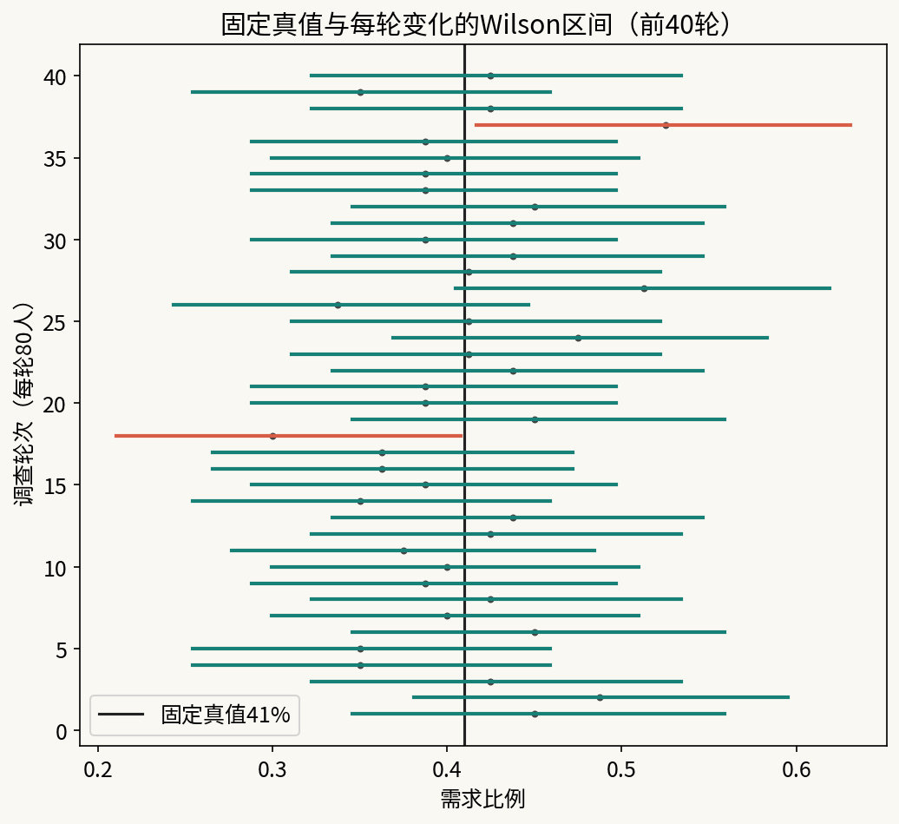
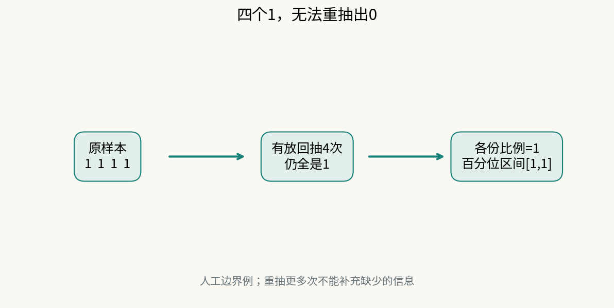

# 第13课｜一个区间，能让我们放心作决定吗？

第12课把同一种调查重复许多次，看到了估计值的波动。现实里通常只做一次调查：这次80人中36人有需求，比例是45%。部门的规划门槛是40%，现在能直接决定扩容吗？

不能只比较45%和40%。随机换一批人，比例可能不同。本课先给估计留出一段不确定范围，再检验造区间的方法是否可靠，最后讨论行动。

### 从“知道波动多大”到“只有一次调查怎么办”

第12课的模拟知道合成总体真值，能用很多次估计看抽样分布；实际调查通常既不知道真值，也不能先做几百次调查。于是要用手头这一份样本估计SE，并按适用模型给出一段不确定范围。接下来先讲最简单的正态近似，再比较它在比例边界上的局限。

## 1. 从一个点到一段范围

先换一个容易手算的小例，不是正式比例调查：估计某个均值为10，标准误为2。假定估计误差的正态近似适用，用1.96作为近似系数：

**10 ± 1.96 × 2 = [6.08, 13.92]。**

10是中心；1.96×2=3.92是向两边留的余量；上下限分别是10−3.92和10+3.92。标准误更大时，余量通常更大。1.96来自标准正态分布的中间95%范围。把估计误差除以SE，相当于用“几个标准误”衡量误差；若这个标准化误差近似标准正态，约95%落在−1.96到1.96之间，便得到上述余量。它不是任何数据都适用的常数。

这样的范围叫**置信区间（confidence interval）**。它不是原始观测的范围，也不是“95%的人落在里面”。本例估计的是一个总体均值，不是在预测下一个人的数值。

## 2. 95%到底在说谁？

想象总体真值固定在一条竖线上。重复抽样，每次重新计算区间，得到许多横线。有的横线跨过真值，有的没有。

先看固定竖线，再逐条看横线是否跨过它。横轴是需求比例，纵轴每一行是一轮独立抽样的结果。图使用本课合成总体的实际模拟，不是现实调查。

**名义95%说的是方法的长期覆盖目标：在适用条件下，重复使用该方法，约95%的区间会覆盖固定真值。** 对于已经得到的一条区间，在这里的频率学派解释下，真值并不会以95%概率在区间内来回变化。

现实调查不知道真值，所以不能检查这次是否覆盖。课堂的合成总体恰好知道真值41%，才可用它评价方法。不能因为知道41%，直接把它填进一次调查的区间中心。

## 3. 用一次真实抽样结果计算比例区间

回到固定4000人合成总体：从完整名册等概率无放回抽80人，所有被抽中者回答。本课默认第一轮种子1301，36人有需求，所以 p̂=36/80=0.45。

一种常见的简单近似是“比例±系数×标准误”。本课的 `wald_fpc` 使用无放回修正：

**估计SE = √[(1−n/N) × p̂(1−p̂)/(n−1)]；区间 = p̂ ± 1.96×估计SE。**

N是总体人数，n是抽到并回答的人数。p̂(1−p̂)描述0/1差异；除以样本规模使均值更稳定；1−n/N反映不放回抽样。程序最后把边界裁到[0,1]，但裁边不能使不可靠的方法变可靠。全0或全1时，这个近似会退化，下一节解释。

为什么还需要另一个方法？简单公式把样本比例直接代进SE；当样本全0或全1时，代入的波动为0，却不代表总体比例已经确定。**Wilson区间（Wilson interval）**通过另一种二项模型计算，同时调整中心与宽度，在这些边界情形仍留出不确定性；这不保证它在任何调查设计下都准确。

默认工具采用Wilson作起点，不要求先背推导。令z≈1.96，先算

- d=1+z²/n；
- 中心 c=(p̂+z²/(2n))/d；
- 半宽 r=z√[p̂(1−p̂)/n+z²/(4n²)]/d；
- 区间为[c−r,c+r]。

把n=80、p̂=.45代入，先得d≈1.048018，中心c≈0.452291，半宽r≈0.106514，再算c−r和c+r，得到约 **[.3458,.5588]**，即34.58%到55.88%。无需背下这个式子，但要知道输入是什么，并能核对36/80、上下限和单位。

这里Wilson公式针对二项模型；在本课低抽样比例下用作近似，没有声称对有限总体严格达到95%。我们会实际检查它在给定抽样设计下的覆盖。抽样比例很大时不能不加说明地沿用；如果完整调查了总体且无测量错误，则没有抽样不确定性。

## 4. 自助法不是“再找一些新的人”

**自助法（bootstrap）**把手头的一份样本当作重抽样材料，有放回抽取同样多条记录，每份算一次比例。把这些比例排序，取2.5%和97.5%分位数，得到百分位区间。它近似的是估计的抽样波动，不是补充新的总体信息。

例如原样本是[0,1,1,0]，比例0.5；有放回重抽4次可能得到[1,0,1,1]，比例0.75，也可能得到[0,0,1,0]，比例0.25。抽过一个值后仍可再抽它，故重抽与“去总体联系新的人”不同。这是另设手算示例，不是正式4000人调查的输出。

另设一个失败小例：只观察到四个人，需求都是1。无论从[1,1,1,1]有放回抽多少遍，每份比例都是1，自助区间永远是[1,1]。这不能证明总体所有人都需要服务。四个1的Wilson区间下限则约.510，而不是1。

先看可抽的四个值，再看每份重抽结果。增加重抽次数不会凭空产生0。普通百分位自助法只作为低抽样比例概率样本下的可选比较，必须检验覆盖；不能用窄区间掩盖自愿回答偏差。

## 5. 覆盖率与宽度要一起看

对同一固定总体重复R次抽样，每次保存上下限。覆盖率=覆盖真值的次数/R；平均宽度=各轮(上限−下限)的平均。

默认n=80、Wilson、R=500、种子从1301起，本次作者实跑覆盖482/500=96.4%，平均宽度约.2094，即20.94个百分点。这是有限模拟结果，不是方法永远有96.4%的保证。覆盖率本身的蒙特卡洛标准误约√[.964×.036/500]=.00833，即0.83个百分点。

把n改大，是改变一次调查的信息量；把R改大，只是更稳定地评价原方法。做区间内部的自助重抽次数B，则是第三个不同的数。三者不要混成“样本数”。

比较两种方法时，最好使用同样的n、总体、抽样机制和每轮样本；本工具相同选择种子能做到这一点。选不同n比较时，只改变n并明确研究的是样本量而非方法。

## 6. 区间如何进入决定？

先由业务目标和代价确定门槛τ，再看最终样本。例如预先讨论“需求超过40%才有理由考虑扩容”。一个保守的三分规则是：

- 下限大于τ：在所用方法的条件下，有证据支持高于门槛；
- 上限小于τ：有证据支持低于门槛；
- 区间跨过或碰到τ：现有证据仍不明确。

默认[.3458,.5588]跨过.40。点估计45%虽更高，区间却不能支持“已明确超过40%”。不明确也不等于没有需求：可以追加调查、有限试行，或依据错误代价采取保守行动。统计区间不能替管理者决定预算、收益和风险偏好；这个规则也不是全局最优决策的证明。

**本课要交的不是一条漂亮的区间，而是：方法适用吗，长期表现怎样，这次证据能支持什么行动？**

按需参考：[NIST比例区间说明](https://www.itl.nist.gov/div898/handbook/prc/section2/prc241.htm)。本课主张与覆盖数据以实际模拟及上述条件为准。
