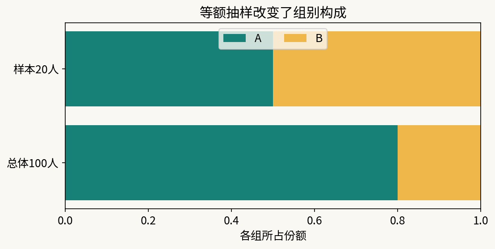
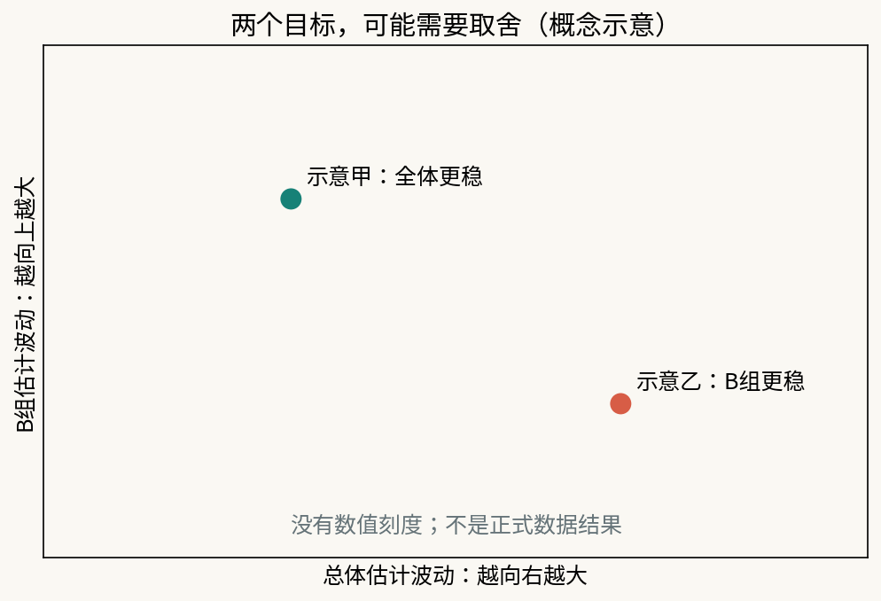

# 第14课｜同样的钱，应该多调查谁？

第13课看到，增加调查人数通常能缩小不确定性。但A组联系一人花1个成本单位，B组花3个；部门预算为240。我们既关心全体需求，又担心人数较少的B组被忽略。把钱平均分给两组，或者把人数按总体比例分配，哪个更合适？

## 1. 先分清“总体有多少人”与“抽了多少人”

另设一个手算小总体：A组80人，B组20人，总体份额是80%和20%。调查20人，按比例可抽16和4；为了多了解B，也可抽10和10。

现在只看等额10/10方案的一份人工样本：A的10人有5人需要服务，B的10人有9人需要服务。两组样本比例为.5和.9。

如果直接把20人合并，比例=(5+9)/20=.70。但样本让B占了50%，总体中B却只占20%。估计总体时应恢复总体构成：

**p̂ = .8×.5 + .2×.9 = .58。**

.70回答的是这份被不等比例抽取的样本中有多少需求者；.58才是按本设计估计总体比例。它仍有随机误差，并非自动等于总体真值。

上方表示总体80/20，下方表示样本10/10。读图时先检查各条的分母，再看为什么合并样本会让B的影响变大。

## 2. 包含概率与设计权重

在上例，A每人被抽到的概率是10/80=.125，B为10/20=.5。这叫**包含概率（inclusion probability）**。

概率的倒数叫**设计权重（design weight）**：A每个样本人代表8人，B每个代表2人。加权需求数=5×8+9×2=58；加权人数=10×8+10×2=100；比例58/100=.58，与总体份额公式相同。

这是先在各层等概率无放回抽取、全部回答的设计。权重来自抽样方案，不是看完结果后给喜欢的一组调权。若回答者不是原来抽中的随机子集，还要额外处理无回答，不能仅凭设计权重保证无偏。

## 3. 回到正式4000人名册

沿用第11、12、13课的同一合成总体：A3200人，B800人。两层互不重叠，共同覆盖目标总体。本课采用**分层抽样（stratified sampling）**：各层独立等概率无放回抽样，基准假设抽中者全部回答。

选择n_A、n_B后：

- 总成本=n_A+3n_B，必须不超过240；
- A包含概率=n_A/3200，设计权重=3200/n_A；
- B包含概率=n_B/800，设计权重=800/n_B；
- 总体估计=.8×A样本比例+.2×B样本比例。

例如128/32满足总体比例4:1，成本128+3×32=224，尚有16未用。这是帮助核对的起点，不是最优分配。你可以调整到更接近预算上限，或把余量保留给现实中未计入的工作，但必须明确成本口径。不能拿未花完的钱当作一种精度优势。

费用表只计邀请；完全回答是理想基准。现实追访和管理也花钱，正式建议需要单独列出，不能宣称上述费用足以保证每人回答。

## 4. 为什么给B更多名额可能有得也有失？

给B更多人数，通常使B组自身比例更稳定；但B更贵，同样预算下可能减少A样本或总人数。A又占总体80%，A的波动可能支配总体估计。

因此不要只问“谁的总样本量更大”，要分别比较：总体估计的标准误、B估计的标准误，以及总成本。

图是取舍示意，不是正式调查结果：两轴分别表示总体估计与B组估计的波动，越靠左下越稳。一个方案可能总体更稳，另一个可能B组更稳，不能只看一项就宣布全面胜出。正式结果请用自己的配置实际计算。

精度的含义沿用第12课：反复执行同一方案，每轮算一个估计，所有估计的标准差近似SE。一次恰好接近真值，不能证明方案长期更好。

## 5. 按需理解理论计算与设计效应

设第h组总体份额W_h、人数N_h、样本量n_h、总体需求比例p_h。完整回答且两层独立时，总体估计的方差为：

**Var(p̂)=Σ W_h² × p_h(1−p_h)/n_h × (N_h−n_h)/(N_h−1)。**

最后取平方根得到SE。这里p_h是已知合成总体真值，用于课堂审核；真实调查不能假装事前知道它。公式告诉我们：各层误差先按总体份额的平方加权，再合并；不是把两个SE简单平均。

**设计效应（design effect）**是指定设计的方差与一个明确参照设计方差之比。本工具参照“同样总人数n的简单随机无放回抽样”。小于1只表示对该参照更稳，不表示在同样成本下最划算。B的费用更高，所以“同人数”与“同预算”不是同一比较。

本课主任务使用重复抽样看总体和B的SE。不强制再做单次区间；若选做，必须匹配分层权重，不能把合并行的普通bootstrap当分层设计区间。

## 6. 把预算减少当成新的决定

先比较预算240下至少两个可行方案，其中一个按总体比例。再让预算降到180，重新选择各层人数。可以优先保持总体精度，也可以优先保证B有足够信息；写出取舍理由，不把教师示例当唯一答案。

无人回答如何处理，也属于调查方案：保留被邀请而未回答的记录、不能随意用方便找到的人顶替；重新评估各层实际响应和未知偏差。若B没有回答，不能把它当需求为0再算全体比例。必要时只报告覆盖到的人群，并提出继续收集什么证据。

最终作品应让另一位调查员知道“从哪份名册怎样抽、联系多少人、预算算哪些成本、没有回答如何记、哪些条件下暂不发布总体结论”。

**更好的方案不是永远给同一组更多人，而是在明确目标、预算和取得机制下，用证据解释取舍。**
